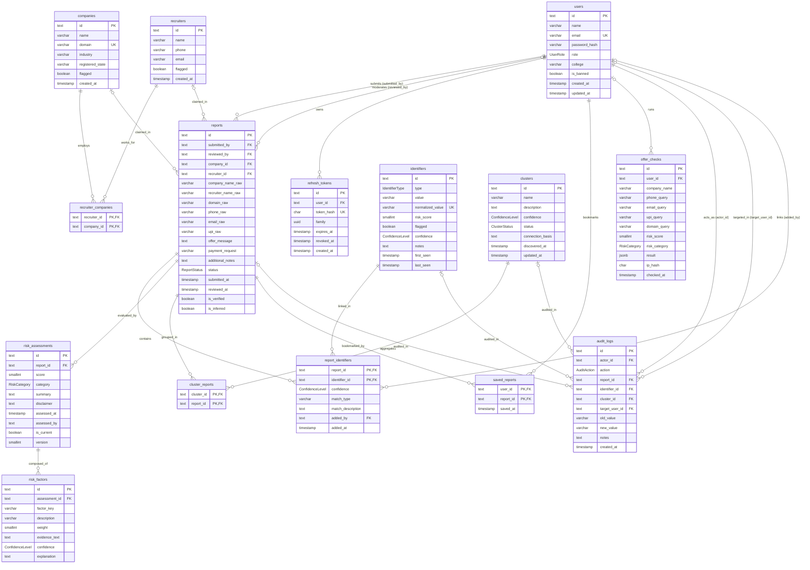

# OfferCheck — Entity-Relationship (ER) Diagram

This document presents the complete Entity-Relationship (ER) model for the **OfferCheck** platform. It visually and textually models all **15 relational database tables**, their internal attributes, primary keys, foreign keys, and cardinalities.

---

## 1. Complete Mermaid ER Diagram

---

## 2. Structural Breakdown of Entities (All 15 Tables)

### Group A: Authentication & User Accounts (2 Tables)
1. **`users`**: Central account table for students and administrators.
   - Primary Key: `id`
   - Key Attributes: `email` (unique), `password_hash` (bcrypt), `role` (`student` or `admin`), `is_banned`.
2. **`refresh_tokens`**: Stateful session management table with cryptographic family chaining.
   - Primary Key: `id`
   - Foreign Key: `user_id` $\to$ `users(id)` (`ON DELETE CASCADE`)
   - Key Attributes: `token_hash` (unique SHA-256), `family` (rotation UUID), `expires_at`, `revoked_at`.

---

### Group B: Corporate Entities & Recruiters (3 Tables)
3. **`companies`**: Legitimate or fabricated business entities referenced in scam offers.
   - Primary Key: `id`
   - Key Attributes: `name`, `domain` (unique when present), `industry`, `flagged`.
4. **`recruiters`**: Individual recruiter personas communicating with students.
   - Primary Key: `id`
   - Key Attributes: `name`, `phone`, `email`, `flagged`.
5. **`recruiter_companies`**: Many-to-many junction modeling recruiters who claim affiliations with multiple organizations.
   - Composite Primary Key: `(recruiter_id, company_id)`
   - Foreign Keys: `recruiter_id` $\to$ `recruiters(id)` (`CASCADE`), `company_id` $\to$ `companies(id)` (`CASCADE`).

---

### Group C: Reporting & Trust Graph Deduplication (3 Tables)
6. **`reports`**: The primary incident entity recording fraudulent job offers reported by students.
   - Primary Key: `id`
   - Foreign Keys: `submitted_by` $\to$ `users(id)` (`RESTRICT`), `reviewed_by` $\to$ `users(id)` (`SET NULL`), `company_id` $\to$ `companies(id)` (`SET NULL`), `recruiter_id` $\to$ `recruiters(id)` (`SET NULL`).
   - Key Attributes: `company_name_raw`, `offer_message`, `payment_request`, `status`, `is_verified`, `is_inferred`.
7. **`identifiers`**: The master deduplication table for all contact handles across all fraud incidents.
   - Primary Key: `id`
   - Candidate Key: `(type, normalized_value)`
   - Key Attributes: `type` (phone/email/upi/domain/bank_account), `value` (raw display), `normalized_value` (canonical format), `risk_score`, `flagged`.
8. **`report_identifiers`**: Many-to-many junction linking reports to identifiers with link-specific evidence.
   - Composite Primary Key: `(report_id, identifier_id)`
   - Foreign Keys: `report_id` $\to$ `reports(id)` (`CASCADE`), `identifier_id` $\to$ `identifiers(id)` (`RESTRICT`), `added_by` $\to$ `users(id)` (`SET NULL`).
   - Key Attributes: `confidence`, `match_type`, `match_description`.

---

### Group D: Risk Intelligence & Scam Syndicates (4 Tables)
9. **`risk_assessments`**: Versioned risk evaluation calculations for individual reports.
   - Primary Key: `id`
   - Foreign Key: `report_id` $\to$ `reports(id)` (`CASCADE`).
   - Key Attributes: `score` (0–100), `category` (low/med/high/crit), `is_current` (partial unique index enforces $\le 1$ active assessment per report), `version`.
10. **`risk_factors`**: Granular contributing factors comprising an assessment.
    - Primary Key: `id`
    - Foreign Key: `assessment_id` $\to$ `risk_assessments(id)` (`CASCADE`).
    - Key Attributes: `factor_key`, `weight`, `explanation`.
11. **`clusters`**: Named scam syndicates grouping related reports sharing fraud infrastructure.
    - Primary Key: `id`
    - Key Attributes: `name`, `status`, `connection_basis`.
12. **`cluster_reports`**: Many-to-many junction connecting reports to scam clusters.
    - Composite Primary Key: `(cluster_id, report_id)`
    - Foreign Keys: `cluster_id` $\to$ `clusters(id)` (`CASCADE`), `report_id` $\to$ `reports(id)` (`CASCADE`).

---

### Group E: User Activity & Compliance Ledger (3 Tables)
13. **`saved_reports`**: Student bookmark junction table.
    - Composite Primary Key: `(user_id, report_id)`
    - Foreign Keys: `user_id` $\to$ `users(id)` (`CASCADE`), `report_id` $\to$ `reports(id)` (`CASCADE`).
14. **`offer_checks`**: Ephemeral lookup log for students verifying suspicious handles before applying.
    - Primary Key: `id`
    - Foreign Key: `user_id` $\to$ `users(id)` (`SET NULL` — allows anonymous checks).
    - Key Attributes: `phone_query`, `email_query`, `upi_query`, `domain_query`, `result` (JSONB point-in-time calculation snapshot), `ip_hash` (HMAC-SHA256 for rate limiting).
15. **`audit_logs`**: Immutable, append-only administrative ledger.
    - Primary Key: `id`
    - Foreign Keys: `actor_id` $\to$ `users(id)` (`RESTRICT`), `report_id` (`SET NULL`), `identifier_id` (`SET NULL`), `cluster_id` (`SET NULL`), `target_user_id` (`SET NULL`).
    - Constraints: CHECK constraint ensuring at least one entity target is present.

---

## 3. Cardinality & Relationship Legend

| Notation | Cardinality Meaning | Practical OfferCheck Example |
|---|---|---|
| `||--o{` | Exactly One to Zero or More | A `User` can submit zero, one, or many `Reports`. |
| `|o--o{` | Zero or One to Zero or More | A `Report` can optionally link to zero or one `Company`, while a `Company` may be linked in many `Reports`. |
| `||--||` | Exactly One to Exactly One | A `User` has exactly one profile record. |
| `M : N` | Many-to-Many | Implemented via junction tables (`report_identifiers`, `recruiter_companies`, `cluster_reports`, `saved_reports`). |
